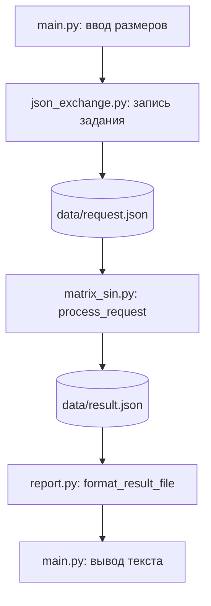

# Интеграция программных модулей

## Задание

Лабораторная работа 3, вариант 20.
Сохранена предметная область ЛР 1–2: расчёт матрицы
a[i][j] = sin(i + j / 2) и подсчёт положительных элементов.
Индексы начинаются с 1.

Стратегия варианта — восходящая интеграция.
На уровне 2 реализован обмен через JSON-файлы.
На уровне 1 используются прямые вызовы функций.

## Состав модулей

- src/matrix_sin.py — создание матрицы и подсчёт положительных элементов.
- src/report.py — форматирование матрицы для вывода.
- src/main.py — ввод размеров, проверка данных и управление вычислениями.

## Стратегия и порядок интеграции

Выбрана восходящая стратегия: сначала проверяются функции
нижнего уровня, затем они подключаются к управляющему модулю.

1. Проверка matrix_sin.py и report.py шестью тестами pytest.
2. Подключение build_matrix и count_positive к main.py.
3. Подключение format_matrix к main.py.
4. Проверка всей программы и повторный запуск тестов.

Стратегия подходит проекту, поскольку расчёт и форматирование
уже реализованы отдельно и могут проверяться без пользовательского ввода.
Тестовые функции выполняют роль драйверов.
Заглушки не требуются: нижние модули доступны.

## Схема взаимодействия

```mermaid
flowchart TD
    U[Пользователь] --> M[main.py: ввод и проверка размеров]
    M --> B[matrix_sin.py: build_matrix]
    B -->|Матрица list[list[float]]| M
    M --> C[matrix_sin.py: count_positive]
    C -->|Количество int| M
    M --> F[report.py: format_matrix]
    F -->|Текст str| M
    M --> O[Вывод матрицы и количества]
```

## Интерфейсы

| Функция | Вход | Выход |
|---|---|---|
| build_matrix(rows, columns) | Два положительных целых размера | Матрица list[list[float]] |
| count_positive(matrix) | Матрица | Количество элементов больше нуля, int |
| format_matrix(matrix) | Матрица | Строка с округлёнными значениями, str |

Матрица передаётся в функции подсчёта и форматирования.
Округление применяется только при формировании текста вывода.
Подсчёт выполняется по исходным значениям.

## Обработка ошибок

main.py перехватывает ValueError при преобразовании ввода в int.
Нулевые и отрицательные размеры отклоняются до вызова вычислений.
При ошибке программа выводит пояснение и завершается с кодом 1.
При успешном выполнении код завершения равен 0.

## Результаты проверки уровня 1

| Проверка | Результат |
|---|---|
| Матрица 3 x 3 | 5 положительных элементов |
| Матрица 1 x 1 | Значение sin(1.5), вывод [1.0], 1 положительный элемент |
| Размеры 0 x 3 | Сообщение об ошибке, код 1 |
| Размеры 3 x -2 | Сообщение об ошибке, код 1 |
| Ввод abc | Сообщение об ошибке, код 1 |
| Ввод 2.5 | Сообщение об ошибке, код 1 |
| pytest до интеграции | 6 passed |
| pytest после интеграции | 6 passed |

## Запуск

Из корня проекта:

```bash
python -m src.main
```

Проверка тестами:

```bash
python -m pytest -v
```

## Реализация уровня 2

Добавлен модуль src/json_exchange.py для записи и чтения
JSON-сообщений, проверки версии формата и преобразования размеров.

Все модули объединены в единую систему.
Управляющие вызовы выполняются функциями Python.
Задание и результат между этапами передаются через JSON-файлы.

### Схема потоков данных



### Формат сообщений

Кодировка файлов — UTF-8.
Каждое сообщение содержит schema_version и объект payload.
Поддерживается версия 1.

Пример задания:

```json
{
  "schema_version": 1,
  "payload": {"n": 1, "m": 1}
}
```

Пример результата:

```json
{
  "schema_version": 1,
  "payload": {
    "matrix": [[0.9974949866040544]],
    "positive_count": 1
  }
}
```

### Сопоставление объектов данных

| Источник | Получатель | Преобразование |
|---|---|---|
| Ввод строк, str | payload.n, int | int и проверка положительности |
| Ввод столбцов, str | payload.m, int | int и проверка положительности |
| payload.n, int | build_matrix: rows, int | Явное соответствие n -> rows |
| payload.m, int | build_matrix: columns, int | Явное соответствие m -> columns |
| Результат build_matrix | payload.matrix | Сериализация вложенных списков в JSON |
| Результат count_positive | payload.positive_count | Сериализация целого числа |
| payload.matrix | format_matrix: matrix | Чтение JSON и передача списка |
| payload.positive_count | Текст результата | Преобразование числа в строку |

request_dimensions проверяет наличие размеров, целочисленный тип
и положительность. Строки и логические значения вместо размеров
не принимаются.

При чтении проверяются структура сообщения и версия формата.
Ошибки чтения, записи и содержимого обрабатываются в main.py.

### Рабочие файлы

Файлы data/request.json и data/result.json создаются при запуске.
Каталог data исключён из Git, поскольку содержит результаты запусков.
Запуск выполняется из корня проекта.

### Проверка взаимодействия

Сценарии и результаты приведены в integration_test.md.

## Реализация уровня 3

main вызывает integration_runner.run_calculation.
Модуль запускает отдельный процесс python -m src.worker.
worker вызывает process_request, который читает request.json
и записывает result.json. Затем report читает результат.

Пути файлов передаются процессу в абсолютном виде.
Рабочим каталогом процесса служит корень проекта.
Для вывода дочернего процесса задаётся кодировка UTF-8.

Время ожидания по умолчанию составляет 5 секунд.
При превышении subprocess.run останавливает дочерний процесс,
а integration_runner сообщает TimeoutError.
При недоступности модуля или ошибке его выполнения возвращается
RuntimeError. main выводит сообщение и завершается с кодом 1.

Неподдерживаемая версия JSON-сообщения вызывает ValueError.
Ошибки файловой системы и некорректные данные также обрабатываются.

Автоматическая проверка задана в .github/workflows/integration.yml:
Windows и Ubuntu, Python 3.14, compileall, flake8,
pytest и покрытие строк не ниже 90 процентов.

Результаты инспекции приведены в code_review.md.
Сравнение стратегий приведено в integration_strategies.md.
